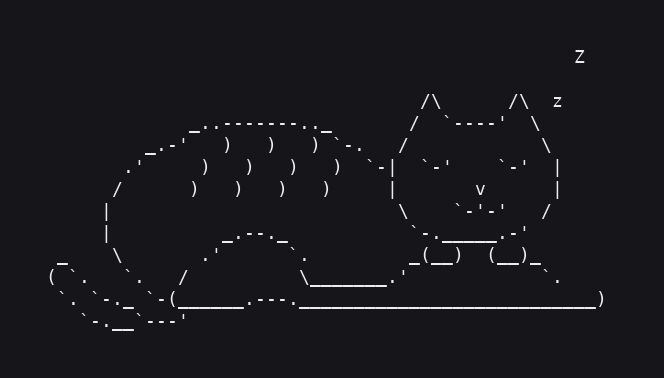

```
    *  .  *       .             *
                         *
 *   .        *       .       .       *
    .     *                   .
        .     .  *        *
```

<h1 align="center">Autumn</h1>

<p align="center">
  <em>Building quiet, private, well-made software — and writing about it along the way.</em>
</p>

<p align="center">
  <a href="https://autumn.grove.place"></a>
  <a href="https://grove.place"></a>
  <a href="https://www.npmjs.com/package/@autumnsgrove/lattice"></a>
  <a href="https://www.npmjs.com/package/@autumnsgrove/lyra"></a>
  <a href="https://ko-fi.com/autumnsgrove"></a>
</p>

## What I'm building

<table>
<tr>
<td width="50%" valign="top">

### 💫 [Nova](https://github.com/AutumnsGrove/nova)
A minimal, pi-inspired agent harness in Go. One binary that runs as a coding agent in the terminal, a headless tool for scripts and CI, a GitHub Action, an HTTP backend, or a library you can embed — the quiet core behind her-go, Polaris, and Ivy.

</td>
<td width="50%" valign="top">

### 🌟 [Lyra](https://github.com/AutumnsGrove/lyra)
A small, portable agent core, sister to Nova: ask the model what to do, run a tool, hand the result back, repeat until the job is done. It keeps an append-only record so an interrupted run resumes where it stopped, runs inside a Cloudflare Worker, and ships as one npm package for any agent application that needs a runtime.

</td>
</tr>
<tr>
<td width="50%" valign="top">

### 🌲 [Lattice](https://github.com/AutumnsGrove/Lattice)
The platform behind [Grove](https://grove.place): blogs, community, auth, storage, and theming for a quieter corner of the internet. A TypeScript monorepo on Cloudflare's edge.

</td>
<td width="50%" valign="top">

### ⭐ [Polaris](https://github.com/AutumnsGrove/Polaris)
A private, self-hosted AI assistant that searches the web through your own SearXNG instance. One Go binary, cited answers, no per-query cost.

</td>
</tr>
<tr>
<td width="50%" valign="top">

### 🚪 [Meridian](https://github.com/AutumnsGrove/Meridian)
The front door to the homelab: one page that links to every self-hosted service, shows whether each one is up, and restarts, updates or stops it from a phone. A Go binary with an embedded SvelteKit front end, a second root-owned binary on the host, and no auth — the tailnet is the access control.

</td>
<td width="50%" valign="top">

### ⚓ [Harbor](https://github.com/AutumnsGrove/Harbor)
A save-anything library for one person, built to replace a Raindrop Pro and mymind subscription with something owned outright. The save path must never fail; everything else is enrichment an agent can add later. Go, embedded SvelteKit, SQLite, and all AI through Nova.

</td>
</tr>
<tr>
<td width="50%" valign="top">

### 🖋️ [Sepia](https://github.com/AutumnsGrove/Sepia)
One private place to review any medium — films, TV, books, games, albums, podcasts, theatre. Type what you thought the way you actually talk, and an agent pulls the title, the year, the creators, and the cover, then asks the handful of questions that turn a paragraph of enthusiasm into a review worth keeping.

</td>
<td width="50%" valign="top">

### 💬 [her-go](https://github.com/AutumnsGrove/her-go)
A privacy-first AI companion with multi-agent memory, mood tracking, and an evolving personality. Inspired by *Her*, built in Go.

</td>
</tr>
<tr>
<td width="50%" valign="top">

### 🎨 [pixelsort-go](https://github.com/AutumnsGrove/pixelsort-go)
A pixel sorter you can watch, live in the browser and along any angle. The engine is Go compiled to WebAssembly, with a SvelteKit studio that exports the process as a GIF, APNG, MP4 or WebM. A ground-up rewrite of the [original Python Pixelsorting](https://github.com/AutumnsGrove/Pixelsorting), which stays as an archive.

</td>
<td width="50%" valign="top">

### 🌿 [Ivy](https://github.com/AutumnsGrove/Ivy)
A self-hosted web mail client for one person: a single Go binary with an embedded SvelteKit frontend that mirrors your IMAP/SMTP mailbox into SQLite for fast search, tags, rules, and careful LLM features. It treats email as hostile, never erases anything, and runs on a small board you reach from your phone over Tailscale.

</td>
</tr>
<tr>
<td width="50%" valign="top">

### ⛏️ [outpost](https://github.com/AutumnsGrove/outpost)
A Minecraft server that exists only while you are playing on it. `outpost start` rents a Hetzner VPS, restores the world from R2, and points DNS at it; when everyone has logged off it saves the world, ships it back, and deletes the server. A two-hour session costs about two cents.

</td>
<td width="50%" valign="top">

</td>
</tr>
</table>

**Also:** [Forage](https://domains.grove.place) (fast domain discovery) · [AmberSync](https://github.com/AutumnsGrove/AmberSync) (Obsidian-style sync on Cloudflare primitives) · [Mycelium](https://github.com/AutumnsGrove/Mycelium) (an MCP server for the Grove ecosystem) · [Warbler](https://github.com/AutumnsGrove/Warbler) (self-hosted voice training) · [Coffer](https://github.com/AutumnsGrove/Coffer) (CSV-first personal finance) · [Nook](https://github.com/AutumnsGrove/Nook) (videos for close friends) · [Verge](https://github.com/AutumnsGrove/verge) (hourly VMs for coding agents) · [Shutter](https://github.com/AutumnsGrove/Shutter) (web content distillation)

---

<p align="center">
  
</p>

<sub>This repo also holds the source of my old personal site, kept as a small [museum](MUSEUM.md) for anyone who likes reading real code.</sub>
